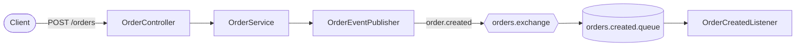

# spring-event-driven-orders

Event-driven microservices with Spring Boot, PostgreSQL, RabbitMQ and Kafka: orders, payments, inventory and notifications.

## Goal

Build REST APIs with Spring Boot and integrating services through asynchronous messaging. It starts with RabbitMQ and will later add PostgreSQL and Kafka, focusing on the problems that show up in real distributed systems: routing, retries, dead-letter queues, idempotency, sagas and the outbox pattern.

## Architecture



`order-service` is organized in layers (`controller`, `service`, `dto`, `event`, `messaging`, `config`). The service layer depends on the `OrderEventPublisher` interface, and `RabbitOrderEventPublisher` is the RabbitMQ implementation, so the broker can be swapped or mocked in tests.

## Stack

- Java 21, Spring Boot 4
- Spring AMQP + RabbitMQ
- Docker Compose
- Planned: PostgreSQL, Kafka, Testcontainers, Kubernetes

## Running locally

Requirements: JDK 21 and Docker.

```bash
cp .env.example .env          # set RabbitMQ credentials
docker compose up -d          # RabbitMQ UI at http://localhost:15672
cd order-service && ./mvnw spring-boot:run
```

Create an order:

```bash
curl -i -X POST localhost:8080/orders \
  -H 'Content-Type: application/json' \
  -d '{"customerId":"c-1","total":99.90}'
```

The API answers `202 Accepted` with the `orderId`, and the listener logs the consumed `OrderCreatedEvent`.

## License

[MIT](LICENSE)
